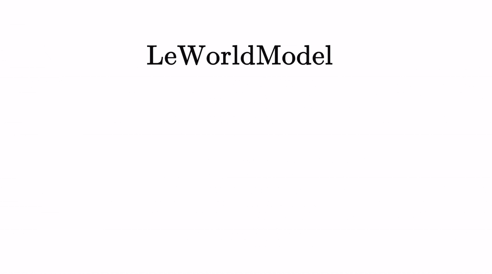

# LeWorldModel
### Stable End-to-End Joint-Embedding Predictive Architecture from Pixels

[Lucas Maes*](https://x.com/lucasmaes_), [Quentin Le Lidec*](https://quentinll.github.io/), [Damien Scieur](https://scholar.google.com/citations?user=hNscQzgAAAAJ&hl=fr), [Yann LeCun](https://yann.lecun.com/) and [Randall Balestriero](https://randallbalestriero.github.io/)

**Abstract:** Joint Embedding Predictive Architectures (JEPAs) offer a compelling framework for learning world models in compact latent spaces, yet existing methods remain fragile, relying on complex multi-term losses, exponential moving averages, pretrained encoders, or auxiliary supervision to avoid representation collapse. In this work, we introduce LeWorldModel (LeWM), the first JEPA that trains stably end-to-end from raw pixels using only two loss terms: a next-embedding prediction loss and a regularizer enforcing Gaussian-distributed latent embeddings. This reduces tunable loss hyperparameters from six to one compared to the only existing end-to-end alternative. With ~15M parameters trainable on a single GPU in a few hours, LeWM plans up to 48× faster than foundation-model-based world models while remaining competitive across diverse 2D and 3D control tasks. Beyond control, we show that LeWM's latent space encodes meaningful physical structure through probing of physical quantities. Surprise evaluation confirms that the model reliably detects physically implausible events.

<p align="center">
   <b>[ <a href="https://arxiv.org/pdf/2603.19312v1">Paper</a> | <a href="https://huggingface.co/collections/quentinll/lewm">Checkpoints &amp; Data</a> | <a href="https://le-wm.github.io/">Website</a> ]</b>
</p>

<br>

<p align="center">
  
</p>

If you find this code useful, please reference it in your paper:
```
@article{maes_lelidec2026lewm,
  title={LeWorldModel: Stable End-to-End Joint-Embedding Predictive Architecture from Pixels},
  author={Maes, Lucas and Le Lidec, Quentin and Scieur, Damien and LeCun, Yann and Balestriero, Randall},
  journal={arXiv preprint},
  year={2026}
}
```

## Using the code
This codebase builds on [stable-worldmodel](https://github.com/galilai-group/stable-worldmodel) for environment management, planning, and evaluation, and [stable-pretraining](https://github.com/galilai-group/stable-pretraining) for training. Together they reduce this repository to its core contribution: the model architecture and training objective.

**Installation:**
```bash
uv venv --python=3.10
source .venv/bin/activate
uv pip install stable-worldmodel[train,env]
```

## Data

Datasets use the HDF5 format for fast loading. Download the data from [HuggingFace](https://huggingface.co/collections/quentinll/lewm) and decompress with:

```bash
tar --zstd -xvf archive.tar.zst
```

Place the extracted `.h5` files under `$STABLEWM_HOME` (defaults to `~/.stable-wm/`). You can override this path:
```bash
export STABLEWM_HOME=/path/to/your/storage
```

Dataset names are specified without the `.h5` extension. For example, `config/train/data/pusht.yaml` references `pusht_expert_train`, which resolves to `$STABLEWM_HOME/pusht_expert_train.h5`.

## Training

`jepa.py` contains the PyTorch implementation of LeWM. Training is configured via [Hydra](https://hydra.cc/) config files under `config/train/`.

Before training, set your WandB `entity` and `project` in `config/train/lewm.yaml`:
```yaml
wandb:
  config:
    entity: your_entity
    project: your_project
```

To launch training:
```bash
python train.py data=pusht
```

Checkpoints are saved to `$STABLEWM_HOME` upon completion.

For baseline scripts, see the stable-worldmodel [scripts](https://github.com/galilai-group/stable-worldmodel/tree/main/scripts/train) folder.

## Planning

Evaluation configs live under `config/eval/`. Set the `policy` field to the checkpoint path **relative to `$STABLEWM_HOME`**, without the `_object.ckpt` suffix:

```bash
# ✓ correct
python eval.py --config-name=pusht.yaml policy=pusht/lewm

# ✗ incorrect
python eval.py --config-name=pusht.yaml policy=pusht/lewm_object.ckpt
```

### Default Cube inference workflow

For the locally installed Cube checkpoint and dataset, run:

```bash
./run_cube_inference.sh
```

Each invocation creates an isolated timestamped directory under `outputs/`.
That directory contains `cube_lewm_inference.mp4`, a PNG preview,
`cube_lewm_results.txt`, the evaluation log, Hydra config, and a copy of the exact
launcher as `run.sh`. The default evaluates one episode;
override it when needed:

```bash
NUM_EVAL=50 ./run_cube_inference.sh
```

Multi-episode runs save one numbered MP4 and PNG preview per episode.

<!-- ogbench-finetune-results:lewm_visual_cube_native224_ft8_20261005_211637:start -->
## OGBench visual Cube 原生224微调与评测（本地实验）

已完成四种 Cube × play/noisy 的 8 个独立模型微调，每模型 80,000 次更新；自动在线评测共 8,000 回合，每模型 1,000 回合。

本次共成功 **16/8000（0.20%）**。最高为 triple-noisy 的 **1.40%**；double-noisy 和 triple-play 各为 0.10%，其余为 0%。训练预测 loss 下降，但本次微调与 CEM 配置的目标任务成功率仍很低。

### 与 OGBench Table 5 对照

单位为成功率百分比。六个 baseline 列逐项取自 [ogbench.pdf 第21页 Table 5](../ogbench/ogbench.pdf#page=21)。论文使用原生64观测，本实验使用原生224；论文标准差来自4个独立训练种子，本次每份数据只微调1个模型，标准差来自4个评测种子。因此此表是不同图像分辨率和种子设置下的参照比较。

| Dataset | GCBC | GCIVL | GCIQL | QRL | CRL | HIQL | LeWM 原checkpoint | LeWM 微调 |
|---|---:|---:|---:|---:|---:|---:|---:|---:|
| visual-cube-single-play-v0 | 5 ± 1 | 60 ± 5 | 30 ± 5 | 41 ± 15 | 31 ± 15 | 89 ± 0 | 0 ± 0 | 0.00 ± 0.00 |
| visual-cube-double-play-v0 | 1 ± 1 | 10 ± 2 | 1 ± 1 | 5 ± 0 | 2 ± 1 | 39 ± 2 | 0 ± 0 | 0.00 ± 0.00 |
| visual-cube-triple-play-v0 | 15 ± 2 | 14 ± 2 | 15 ± 1 | 16 ± 1 | 17 ± 2 | 21 ± 0 | 0 ± 0 | 0.10 ± 0.17 |
| visual-cube-quadruple-play-v0 | 8 ± 1 | 0 ± 0 | 7 ± 1 | 5 ± 1 | 4 ± 1 | 14 ± 1 | 0 ± 0 | 0.00 ± 0.00 |
| visual-cube-single-noisy-v0 | 14 ± 3 | 75 ± 3 | 48 ± 3 | 10 ± 5 | 39 ± 30 | 99 ± 0 | 0 ± 0 | 0.00 ± 0.00 |
| visual-cube-double-noisy-v0 | 5 ± 1 | 17 ± 4 | 22 ± 2 | 6 ± 2 | 6 ± 3 | 59 ± 3 | 0 ± 0 | 0.10 ± 0.17 |
| visual-cube-triple-noisy-v0 | 16 ± 1 | 18 ± 1 | 12 ± 1 | 9 ± 4 | 16 ± 1 | 23 ± 2 | 0 ± 0 | 1.40 ± 0.66 |
| visual-cube-quadruple-noisy-v0 | 9 ± 0 | 0 ± 0 | 2 ± 2 | 0 ± 0 | 8 ± 2 | 12 ± 8 | 0 ± 0 | 0.00 ± 0.00 |

原checkpoint列来自先前固定 single-cube 权重在四种 Cube 上各1,000回合的评测；play/noisy共用该结果。多方块原checkpoint列属于跨环境迁移；微调列则是各自数据训练的独立模型。

### 训练与评测条件

- 八个模型均从本地原始 `cube-lewm` checkpoint初始化，全部参数参与更新。batch=128，AdamW lr=1e-5，5% warmup后cosine；训练目标为预测MSE + 0.09×SIGReg。
- 官方 train NPZ用于优化及动作标准化，独立 `-val.npz`仅用于验证。图片由同一帧qpos/qvel还原后直接渲染为224×224；训练、验证、在线观测、goal及原始视频均为原生224。模型输入为RGB和动作，qpos/qvel仅用于重渲染。
- 原顺序验证batch中的连续轨迹会抬高SIGReg统计量；最终从所有已保存epoch中按**完整独立val集最低预测MSE**选择评测权重。原组合指标和训练权重均保留，详见每模型的 `prediction-checkpoint-selection.json`。W&B中的 `val/pred_loss` 是预测误差；原 `val/loss` 包含SIGReg，不能与随机训练batch的总loss直接比较。
- 每模型使用5个官方目标 × 4个评测seed（0,1,2,3）× 50回合。CEM：300 samples，30 iterations，30 elites；horizon=5，receding=5，action block=5，observed history=1。每模型保存5段原始224视频，共40段，无白边。

### 成功数、选中权重与训练记录

| Dataset | 成功数 / 回合数 | val预测MSE | 选中checkpoint | W&B |
|---|---:|---:|---|---|
| visual-cube-single-play-v0 | 0 / 1000 | 0.003454 | [epoch 11](outputs/lewm_visual_cube_native224_ft8_20261005_211637/training/visual-cube-single-play-v0/checkpoints/epoch_11) | [loss与评测](https://wandb.ai/visual-intelligence-laboratory/P-Rep/runs/02d2eeeb956d) |
| visual-cube-single-noisy-v0 | 0 / 1000 | 0.012328 | [epoch 9](outputs/lewm_visual_cube_native224_ft8_20261005_211637/training/visual-cube-single-noisy-v0/checkpoints/epoch_09) | [loss与评测](https://wandb.ai/visual-intelligence-laboratory/P-Rep/runs/49644b5ddd5f) |
| visual-cube-double-play-v0 | 0 / 1000 | 0.005578 | [epoch 9](outputs/lewm_visual_cube_native224_ft8_20261005_211637/training/visual-cube-double-play-v0/checkpoints/epoch_09) | [loss与评测](https://wandb.ai/visual-intelligence-laboratory/P-Rep/runs/27125ca414fb) |
| visual-cube-double-noisy-v0 | 1 / 1000 | 0.013212 | [epoch 10](outputs/lewm_visual_cube_native224_ft8_20261005_211637/training/visual-cube-double-noisy-v0/checkpoints/epoch_10) | [loss与评测](https://wandb.ai/visual-intelligence-laboratory/P-Rep/runs/9e583c5d81b0) |
| visual-cube-triple-play-v0 | 1 / 1000 | 0.005754 | [epoch 3](outputs/lewm_visual_cube_native224_ft8_20261005_211637/training/visual-cube-triple-play-v0/checkpoints/epoch_03) | [loss与评测](https://wandb.ai/visual-intelligence-laboratory/P-Rep/runs/2f90dc4920b7) |
| visual-cube-triple-noisy-v0 | 14 / 1000 | 0.011127 | [epoch 3](outputs/lewm_visual_cube_native224_ft8_20261005_211637/training/visual-cube-triple-noisy-v0/checkpoints/epoch_03) | [loss与评测](https://wandb.ai/visual-intelligence-laboratory/P-Rep/runs/6c4bff782f40) |
| visual-cube-quadruple-play-v0 | 0 / 1000 | 0.006280 | [epoch 2](outputs/lewm_visual_cube_native224_ft8_20261005_211637/training/visual-cube-quadruple-play-v0/checkpoints/epoch_02) | [loss与评测](https://wandb.ai/visual-intelligence-laboratory/P-Rep/runs/05a5b67ba674) |
| visual-cube-quadruple-noisy-v0 | 0 / 1000 | 0.010974 | [epoch 3](outputs/lewm_visual_cube_native224_ft8_20261005_211637/training/visual-cube-quadruple-noisy-v0/checkpoints/epoch_03) | [loss与评测](https://wandb.ai/visual-intelligence-laboratory/P-Rep/runs/2d8210bffdf2) |

- [完整指标](outputs/lewm_visual_cube_native224_ft8_20261005_211637/metrics.json)、[全部结果核对](outputs/lewm_visual_cube_native224_ft8_20261005_211637/completion-verification.json)、[运行配置](outputs/lewm_visual_cube_native224_ft8_20261005_211637/manifest.json)。
- [逐任务成功率及实验说明](zeyu-understand.md#ogbench)、[评测记录和40段视频](outputs/lewm_visual_cube_native224_ft8_20261005_211637/evaluation)、[八个模型的训练日志与权重](outputs/lewm_visual_cube_native224_ft8_20261005_211637/training)。
- [W&B项目](https://forge.coreweave.com/wandb/visual-intelligence-laboratory/P-Rep)。
- 执行入口：`launch_ogbench_finetune_8gpu.sh` → `run_ogbench_finetune_pipeline.py`；本次输出目录为 `outputs/lewm_visual_cube_native224_ft8_20261005_211637`。
<!-- ogbench-finetune-results:lewm_visual_cube_native224_ft8_20261005_211637:end -->

## Pretrained Checkpoints

Pretrained LeWM checkpoints for each environment are mirrored on the Hugging Face
Hub (model repos), alongside the datasets (dataset repos) in the same collection:

- [`quentinll/lewm-pusht`](https://huggingface.co/quentinll/lewm-pusht)
- [`quentinll/lewm-cube`](https://huggingface.co/quentinll/lewm-cube)
- [`quentinll/lewm-tworooms`](https://huggingface.co/quentinll/lewm-tworooms)
- [`quentinll/lewm-reacher`](https://huggingface.co/quentinll/lewm-reacher)

The full baseline checkpoint suite (PLDM, LeJEPA, IVL, IQL, GCBC, DINO-WM, DINO-WM-noprop)
is available on [Google Drive](https://drive.google.com/drive/folders/1r31os0d4-rR0mdHc7OlY_e5nh3XT4r4e):

<div align="center">

| Method | two-room | pusht | cube | reacher |
|:---:|:---:|:---:|:---:|:---:|
| pldm | ✓ | ✓ | ✓ | ✓ |
| lejepa | ✓ | ✓ | ✓ | ✓ |
| ivl | ✓ | ✓ | ✓ | — |
| iql | ✓ | ✓ | ✓ | — |
| gcbc | ✓ | ✓ | ✓ | — |
| dinowm | ✓ | ✓ | — | — |
| dinowm_noprop | ✓ | ✓ | ✓ | ✓ |

</div>

## Loading a checkpoint

### From the Drive archive

Each tar archive contains two files per checkpoint:
- `<name>_object.ckpt` — a serialized Python object for convenient loading; this is what `eval.py` and the `stable_worldmodel` API use
- `<name>_weight.ckpt` — a weights-only checkpoint (`state_dict`) for cases where you want to load weights into your own model instance

Place the extracted files under `$STABLEWM_HOME/` and load via:

```python
import stable_worldmodel as swm

# Load the cost model (for MPC)
cost = swm.policy.AutoCostModel('pusht/lewm')
```

`AutoCostModel` accepts:
- `run_name` — checkpoint path **relative to `$STABLEWM_HOME`**, without the `_object.ckpt` suffix
- `cache_dir` — optional override for the checkpoint root (defaults to `$STABLEWM_HOME`)

The returned module is in `eval` mode with its PyTorch weights accessible via `.state_dict()`.

### From the Hugging Face mirror

The HF model repos ship the LeWM checkpoint as a `weights.pt` (state dict) plus a
`config.json` describing the model. Convert once to produce the `_object.ckpt`
that `eval.py` expects:

```bash
# download weights.pt + config.json
hf download quentinll/lewm-pusht --local-dir $STABLEWM_HOME/hf_pusht

# convert to object checkpoint under $STABLEWM_HOME/pusht/lewm_object.ckpt
python - <<'PY'
import json, torch, stable_pretraining as spt
from pathlib import Path
from jepa import JEPA
from module import ARPredictor, Embedder, MLP
import stable_worldmodel as swm

src = Path(swm.data.utils.get_cache_dir(), "hf_pusht")
out = Path(swm.data.utils.get_cache_dir(), "pusht", "lewm_object.ckpt")

cfg = json.loads((src / "config.json").read_text())
encoder = spt.backbone.utils.vit_hf(
    cfg["encoder"]["size"],
    patch_size=cfg["encoder"]["patch_size"],
    image_size=cfg["encoder"]["image_size"],
    pretrained=False, use_mask_token=False,
)
mlp = lambda k: MLP(input_dim=cfg[k]["input_dim"], output_dim=cfg[k]["output_dim"],
                    hidden_dim=cfg[k]["hidden_dim"], norm_fn=torch.nn.BatchNorm1d)
model = JEPA(
    encoder=encoder,
    predictor=ARPredictor(**cfg["predictor"]),
    action_encoder=Embedder(**cfg["action_encoder"]),
    projector=mlp("projector"),
    pred_proj=mlp("pred_proj"),
)
sd = torch.load(src / "weights.pt", map_location="cpu", weights_only=False)
model.load_state_dict(sd, strict=True)
out.parent.mkdir(parents=True, exist_ok=True)
torch.save(model, out)
PY
```

After conversion, load via `swm.policy.AutoCostModel('pusht/lewm')` as usual.

## Contact & Contributions
Feel free to open [issues](https://github.com/lucas-maes/le-wm/issues)! For questions or collaborations, please contact `lucas.maes@mila.quebec`
